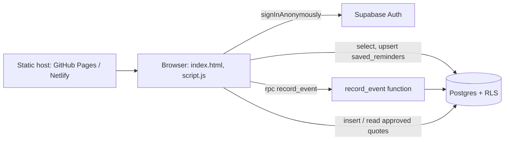

# Architecture

## Overview

A static single-page app talks directly to Supabase. There is no custom server: the database enforces the rules.

## Key decisions

| Decision | Why |
| --- | --- |
| Anonymous auth | No sign-up friction, but each visitor still gets a real `auth.uid()` to scope RLS. |
| Public anon key | Unavoidable on a static site; RLS is the security boundary. |
| XP in a `security definer` function | The client is untrusted. The server decides how much XP an event is worth and enforces the daily cap. |
| Levels computed in the client | Level = `floor(xp / 100)`. It is derived data, so nothing extra is stored. |
| Local fallback | The app stays usable without Supabase and is easy to preview. |
| No streaks | Progress is about XP and levels only: no pressure to return daily. |

## Data model

- `profiles(id, xp, created_at)`: one row per anonymous user, created by a trigger on `auth.users`. Read-only for clients.
- `saved_reminders(user_id, reminder_number)`: owner-only via RLS.
- `reminder_activity(user_id, reminder_number, event_type, xp_awarded, created_at)`: written only by `record_event()`; used for the daily XP cap and future analytics.
- `public_quotes(id, quote, approved, created_at)`: no identity fields; inserts must be unapproved, reads show approved only.

## XP flow

1. The user clicks "Give me another" or saves a reminder.
2. The client calls `rpc('record_event', { p_reminder, p_event })`.
3. The function validates the input, sums today's awarded XP, decides the reward (`next` +10, first `save` +10), applies the cap, logs the event and updates `profiles.xp`.
4. It returns `{ xp, awarded }`; the client updates the level bar and shows the `+XP` pop-up.

## User separation

Each browser session gets its own anonymous user ID, stored by Supabase in browser storage. To test another user, use a private window.
